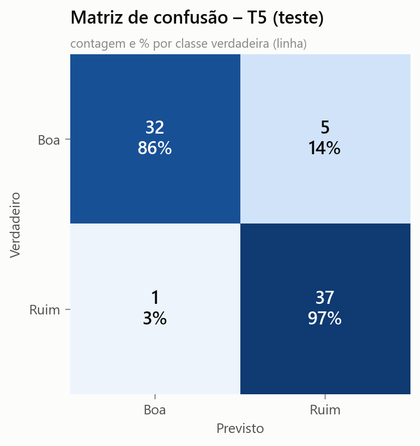
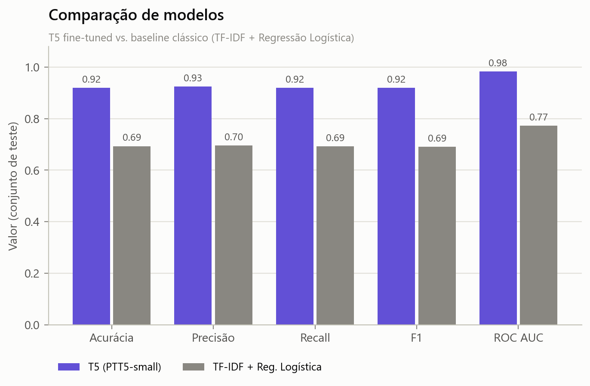
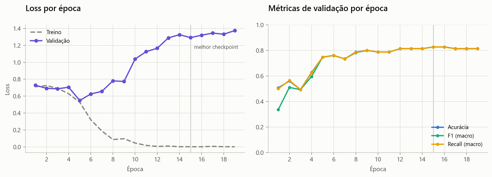
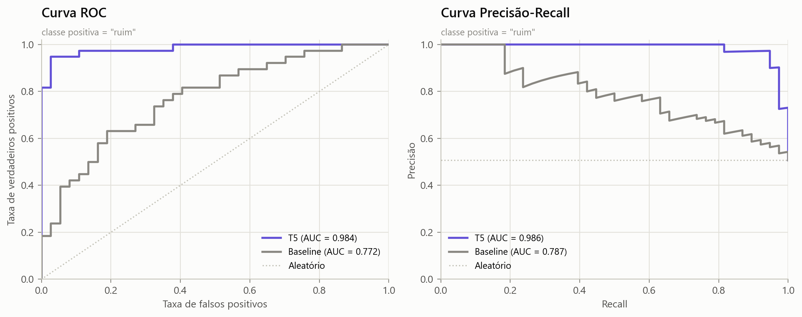
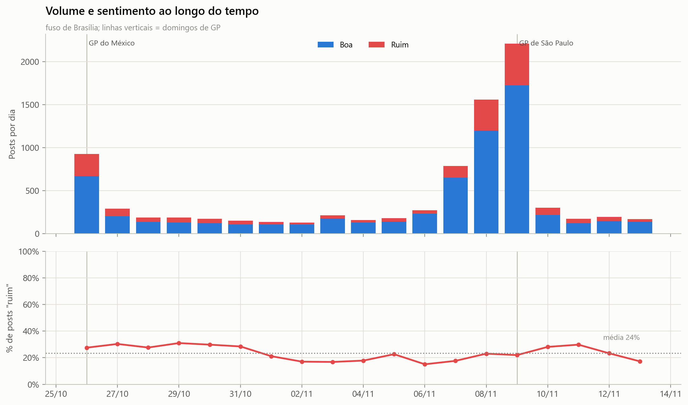
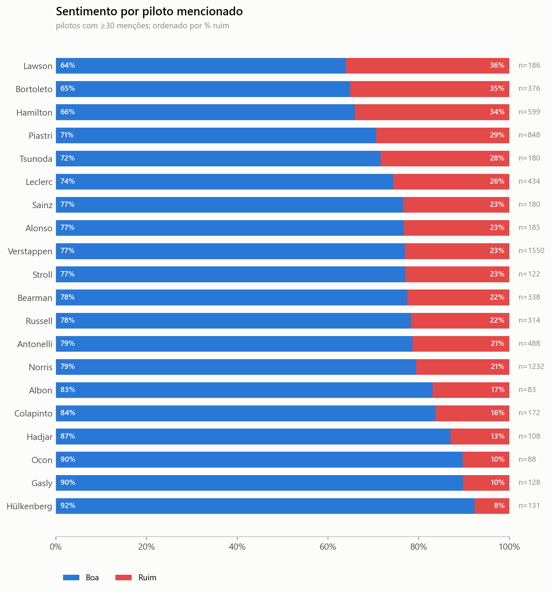
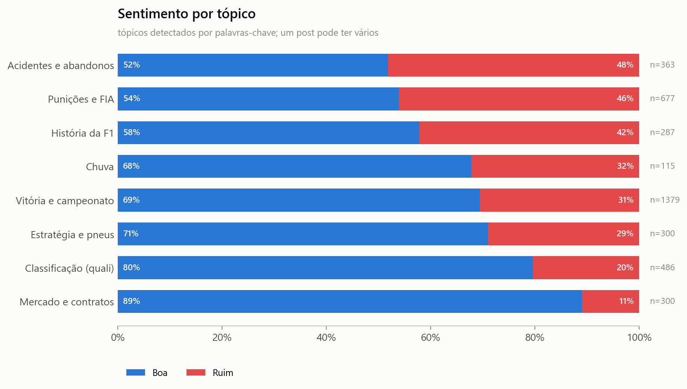

# F1 Post Analyzer

Sentiment analysis (positive/negative) of Formula 1 posts collected from Bluesky, using a T5 model (PTT5) fine-tuned for Portuguese, followed by an analysis of ~9k posts by driver, team, topic and time.

## Results

| Model (held-out test set, n=75) | Accuracy | Precision | Recall | F1 | ROC AUC |
|---|---|---|---|---|---|
| **T5 (PTT5-small, fine-tuned)** | **0.920** | **0.925** | **0.919** | **0.920** | **0.984** |
| Baseline: TF-IDF + Logistic Regression | 0.693 | 0.697 | 0.692 | 0.691 | 0.772 |

The baseline reaches 0.715 ± 0.010 accuracy in 5-fold cross-validation. The test set is small (75 posts), so expect a few points of variation between splits.

<p>
  
  
</p>




### What the ~9k posts show



<p>
  
  
</p>

- Post volume peaks on race weekends (Mexico GP and São Paulo GP).
- *Accidents* and *penalties/FIA* are the most negative topics (~45–48% "ruim"). *Contracts/market* is the most positive (89% "boa").
- Ferrari is the most-mentioned team and the most negative of the big teams (34% "ruim").
- Negative posts tend to be longer (median 145 vs 110 characters).

All charts are in [`resultados/`](resultados/).

## Pipeline

1. **Collection**: F1 posts scraped from Bluesky (`posts_formula1_10k.csv`) and translated to Portuguese (`posts_traduzidos.csv`).
2. **Labeling**: balanced sample labeled as `boa` / `ruim` (`f1_posts_rotulados_balanceado.csv`).
3. **Cleaning**: links removed, duplicates dropped (to avoid train/test leakage), and trending-topic bots/spam filtered out of the analysis set.
4. **Training**: fine-tuning `unicamp-dl/ptt5-small-portuguese-vocab` with a 70/15/15 train/validation/test split, early stopping, and best checkpoint chosen by validation F1.
5. **Calibration**: temperature scaling on the validation set. It does not change predictions, but makes the confidence scores meaningful (validation log-loss 1.29 → 0.43).
6. **Evaluation**: metrics, confusion matrix, ROC/PR curves, comparison against a classic baseline, and error analysis.
7. **Analysis**: classification of all posts plus breakdowns by driver, team, topic, hashtag, author, time and post length.

## Project structure

| File | Description |
|---|---|
| `config.py` | Paths, labels, hyperparameters and chart colors, all in one place |
| `dados.py` | Loading, cleaning, deduplication, spam filter and train/val/test split |
| `modelo.py` | Loads the saved model and runs batched inference with calibrated probabilities |
| `graficos.py` | Shared chart style and plotting functions (PNG, 200 dpi) |
| `treinar.py` | Trains, calibrates and evaluates the model and saves everything to `resultados/1_modelo/` |
| `analise_posts.py` | Classifies the ~9k posts and saves the analysis to `resultados/2_analise_posts/` |
| `teste.py` | Classifies a single text, either from the command line or interactively |

### Generated outputs

```
resultados/
├── 1_modelo/
│   ├── 01_matriz_confusao.png            confusion matrix (counts + %)
│   ├── 02_relatorio_classificacao.png    precision / recall / F1 table
│   ├── 03_comparacao_modelos.png         T5 vs baseline
│   ├── 04_curvas_aprendizado.png         loss and validation metrics per epoch
│   ├── 05_curvas_roc_pr.png              ROC and precision-recall curves
│   ├── 06_confianca_previsoes.png        confidence of correct vs wrong predictions
│   ├── 07_matriz_confusao_baseline.png
│   ├── metricas.json                     all metrics in one file
│   ├── classification_report.csv
│   ├── historico_treino.csv
│   └── erros_teste.csv                   misclassified posts, for error analysis
└── 2_analise_posts/
    ├── 01_distribuicao_sentimento.png    03_sentimento_por_piloto.png
    ├── 02_sentimento_ao_longo_do_tempo.png  04_sentimento_por_equipe.png
    ├── 05_sentimento_por_topico.png      06_top_hashtags.png
    ├── 07_palavras_por_sentimento.png    08_atividade_dia_hora.png
    ├── 09_sentimento_por_autor.png       10_tamanho_post.png
    ├── posts_classificados.csv           every post with its sentiment + confidence
    ├── tabela_pilotos.csv / tabela_equipes.csv / tabela_topicos.csv
    └── resumo.json
```

## Usage

```bash
pip install -r requirements.txt

python treinar.py                 # train + evaluate (~20 min on CPU)
python analise_posts.py           # classify and analyze the posts (~5 min on CPU, cached afterwards)
python teste.py "Que corrida incrível do Norris!"
```

Useful options:

```bash
python treinar.py --so-avaliar        # re-evaluate the saved model without retraining
python treinar.py --nao-mostrar       # save charts without opening windows
python treinar.py --modelo-base t5_f1_sentiment_model --dados novos_rotulados.csv   # continue training
python analise_posts.py --reclassificar
```

All paths are relative to the project folder, so nothing needs to be edited before running.

## Labels

- `boa` → positive (index `0`)
- `ruim` → negative (index `1`)

## Limitations and next steps

- **No neutral class.** Many posts are plain news, and with no neutral option the model tends to call them "boa". That is why the words most associated with "boa" are news terms (`#sprintquali`, `horário`, `lançamento`). Adding a `neutro` label would be the biggest improvement.
- **Small, noisy dataset.** There are ~500 labeled posts, and some labels are debatable. The model reaches F1 = 1.00 on the training set, a sign of memorization. More labeled data would reduce variance more than any hyperparameter change.
- Driver, team and topic detection uses keyword matching, so it can miss nicknames and misclassify ambiguous terms.
